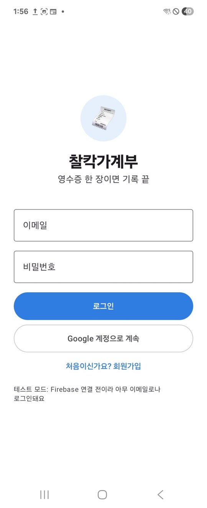
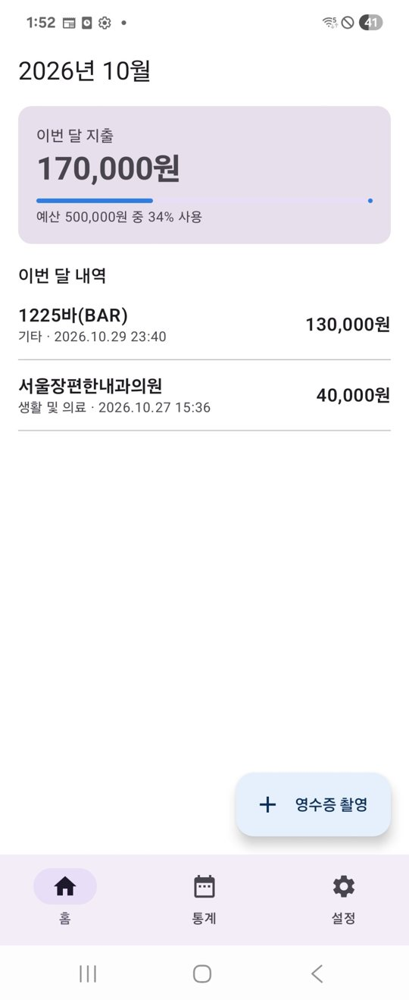
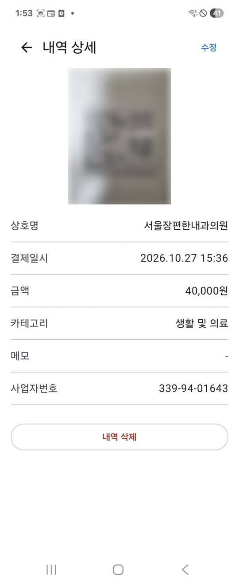
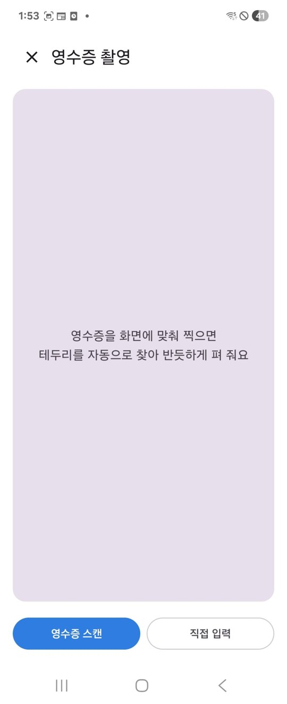
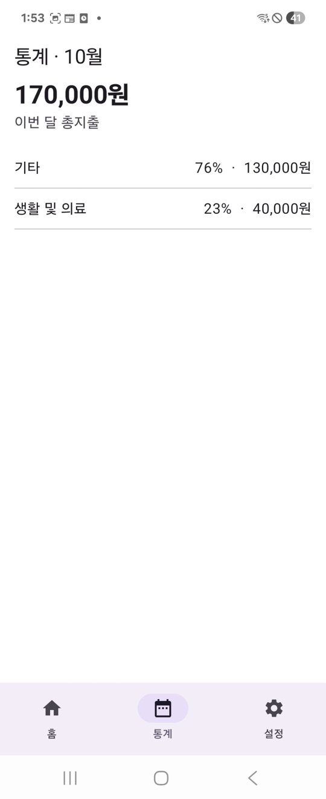
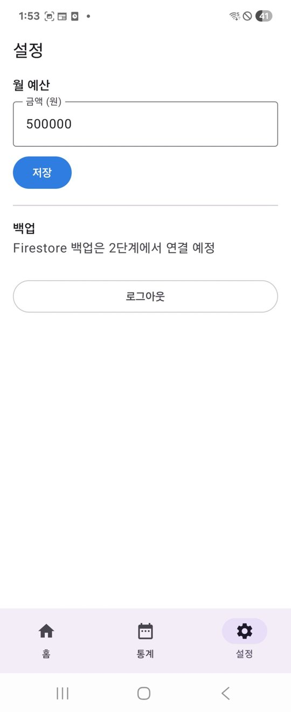

# 찰칵가계부 (SnapLedger) · 중간 점검 보고

> 모바일프로그래밍 팀 프로젝트 · 김윤호, 정일현
> 영수증을 찍으면 상호명·결제일시·금액·카테고리가 자동으로 기록되는 안드로이드 가계부 앱

---

## 1. 개발 현황 요약

### 전체 기능 중 구현 완료된 항목: **약 65%**

제안서의 기능을 22개 항목으로 나눠 계산했다. 완료 1점, 코드는 있으나 외부 설정·검증이 남은 항목 0.5점으로 셌다(14.5 / 22).

| 구분 | 항목 | 상태 |
|---|---|---|
| 로그인 | 로그인·회원가입 화면 (이메일, Google) | ✅ 완료 |
| | Firebase Authentication 연결 | 🟡 코드 완료, Firebase 프로젝트 연결 전 (현재 테스트 모드) |
| 핵심 기능 1 영수증 → 자동 입력 | 영수증 스캔 (테두리 자동 인식·반듯하게 펴기·보정) | ✅ 완료 |
| | ML Kit 한국어 글자 인식 (기기 안에서 처리) | ✅ 완료 |
| | 규칙 기반 파서 (상호명·결제일시·합계·사업자번호) | ✅ 완료 |
| | 인식 결과 확인·수정 화면, 빈 칸 강조 | ✅ 완료 |
| | 중복 내역 경고 | ✅ 완료 |
| | 영수증 위에 읽은 위치 박스 표시 | ⬜ 예정 |
| 핵심 기능 2 분류 + 분석 | 사용자 규칙 분류 (바꾼 카테고리 기억) | ✅ 완료 |
| | 내장 키워드 사전 분류 | ✅ 완료 |
| | 카카오 로컬 API 업종 분류 | 🟡 코드 완료, API 키 연결 전 |
| | 카테고리별 지출 비중 | 🟡 목록으로 완료, 도넛 차트 예정 |
| | 일별 막대 차트·전월 대비·자주 간 가게 TOP 3 | ⬜ 예정 |
| 부가 기능 | 홈: 이번 달 지출·예산 진행률·최근 내역 | ✅ 완료 |
| | 내역 상세 (원본 영수증·수정·삭제) | ✅ 완료 |
| | 직접 입력 | ✅ 완료 |
| | 월 예산 설정 | ✅ 완료 |
| | 예산 80%·100% 알림 | ⬜ 예정 |
| | 영수증 보관함 검색 | ⬜ 예정 |
| | Firestore 백업·복원 | ⬜ 예정 |
| | CSV 내보내기 (여유 시) | ⬜ 예정 |
| 테스트 | 영수증 파서 단위 테스트 (JUnit, 9개 사례) | ✅ 완료 |

### 현재까지 완료한 주요 기능

1. **영수증 촬영 → 자동 입력 흐름 전체 동작**
   홈의 [영수증 촬영] → 문서 스캐너로 영수증 촬영 → ML Kit 글자 인식 → 파서가 상호명·결제일시·합계·사업자번호 추출 → 확인 화면에서 저장.
2. **인식 정확도 개선 (전처리 + 행 단위 파싱)**
   - ML Kit Document Scanner로 배경을 잘라내고, 기울어진 영수증을 반듯하게 편 뒤 인식한다.
   - 같은 높이의 글자를 한 행으로 합쳐 `합계 7,500`처럼 항목과 값을 함께 읽는다.
   - 글자 높이를 재서 가장 크게 인쇄된 줄을 상호명 후보로 우선한다.
   - 승인번호·카드번호·가맹점번호·전화번호를 금액에서 제외한다.
   - 하이픈 없는 사업자번호는 국세청 검증 공식으로 확인한다.
3. **카테고리 자동 분류**
   사용자 규칙 → 내장 키워드 사전 → 카카오 로컬 API 순서로 시도한다. 예: '서울장편한내과의원' → 생활 및 의료.
4. **지출 관리 화면**
   홈(이번 달 합계·예산 진행률·최근 내역), 내역 상세(원본 영수증·수정·삭제), 통계(카테고리별 비중), 설정(월 예산).
5. **로그인 구조**
   이메일 회원가입·로그인과 Google 로그인(Credential Manager → Firebase Auth) 코드를 완성했다. Firebase 설정 파일이 없으면 자동으로 테스트 모드로 동작한다.

---

## 2. 주요 구현 화면

| 로그인 | 목록 (홈) | 상세 보기 |
|:---:|:---:|:---:|
|  |  |  |
| 이메일·Google 로그인, 회원가입 이동 | 이번 달 지출, 예산 진행률, 내역 목록 | 원본 영수증, 인식된 값, 수정·삭제 |

| 영수증 촬영 | 통계 | 설정 |
|:---:|:---:|:---:|
|  |  |  |
| 문서 스캐너 실행, 직접 입력 | 이번 달 총지출, 카테고리별 비중 | 월 예산, 백업(예정), 로그아웃 |

> 상세 화면의 영수증 사진은 승인번호 등 개인정보 때문에 흐리게 처리했다.

---

## 3. GitHub 링크 및 commit 내역

- **주요 코드**: 기능별 핵심 파일과 설명은 [SnapLedger_mid/key_code/](../../SnapLedger_mid/key_code/README.md) 폴더에 정리했다.

- **GitHub URL**: https://github.com/iamyuno12-hash/MP_Project
- **주요 commit**: 기능 단위로 나눠 commit하고, 메시지에 변경 내용을 적었다.

| commit 메시지 | 내용 |
|---|---|
| `프로젝트 기본 구조 생성 (Compose, Navigation, MVVM)` | 화면 7개 뼈대, AppContainer, 테마 |
| `Room 지출 내역 DB와 Repository 구현` | Expense·CategoryRule 엔티티, DAO, ExpenseRepository |
| `로그인·회원가입 화면과 Firebase Auth·Google 로그인 연동 코드` | AuthRepository, 테스트 모드 자동 전환 |
| `홈·상세·직접 입력·통계·설정 화면 구현` | 이번 달 합계, 예산 진행률, 수정·삭제 |
| `ML Kit 한국어 인식과 규칙 기반 영수증 파서 추가` | ReceiptParser, 파서 단위 테스트 |
| `문서 스캐너 전처리와 행 단위 파싱으로 인식 정확도 개선` | 승인번호 오인식, 상호명 오인식 수정 |
| `휘어진 영수증 대응: 항목·값이 한 줄 밀린 경우 처리` | 상호 칸 이웃 줄 비교, 사업자번호 검증 |
| `홈 목록을 최근 저장 순으로 변경, 저장 결과 알림 추가` | 날짜가 이번 달이 아니어도 저장 내역 표시 |

### 문제 해결 사례 (요약)

| 문제 | 원인 | 해결 |
|---|---|---|
| 승인번호(8자리)를 결제 금액으로 인식 | 숫자만 보고 금액 후보로 판단 | 번호류 항목 줄 제외, 쉼표·'원'이 붙은 숫자만 금액으로 인정 |
| '상호:' 표기가 없는 영수증에서 상호명 오인식 | 키워드에만 의존 | 문서 스캐너 전처리 + 글자 크기·위치 점수로 상호명 추정 |
| 휘어진 영수증에서 대표자 이름을 상호명으로 인식 | 오른쪽 값이 한 줄씩 밀려 읽힘 | 상호 칸의 위·아래 줄까지 비교, 대표 칸 근처의 사람 이름은 제외 |
| Firebase 라이브러리 빌드 실패 | 최신 Firebase가 더 높은 Kotlin 버전으로 빌드됨 | 프로젝트 Kotlin 버전에 맞는 Firebase BoM으로 고정 |
| 저장한 내역이 홈에 안 보임 | 홈 목록이 결제일이 이번 달인 내역만 표시 | 최근 저장 순 목록으로 변경, 합계만 이번 달 기준 |

---

## 4. 다음 단계 계획

### 잔여 기능 개발 계획

| 기간 | 김윤호 (프론트엔드) | 정일현 (백엔드/DB) |
|---|---|---|
| ~11/18 (중간 점검) | 인식 결과 화면에 읽은 위치 박스 표시 | Firebase 프로젝트 연결 (이메일·Google 로그인 실제 동작), 카카오 API 키 연결 |
| 11/19~11/25 | 통계 도넛 차트·일별 막대 차트 (Compose Canvas), 전월 대비·TOP 3 | Firestore 백업(저장 시 업로드)·복원(새 기기 로그인 시) |
| 11/26~12/01 | 영수증 보관함 검색 화면, UI 다듬기 | 월 예산 80%·100% 알림 (WorkManager + 알림 권한) |
| 공동 | 실제 영수증 30장 테스트셋으로 항목별 인식률 측정 → 파서 규칙 보완, APK·시연 영상·최종 보고서 | |

### 보완할 UI 또는 기능

- **분류 정확도**: 카카오 API 키를 연결하면 업종 조회로 '1225바(BAR)' 같은 가게도 '기타'가 아닌 카테고리로 분류된다.
- **인식 결과 확인 화면**: 영수증 위에 읽은 위치를 표시해, 어디서 값을 가져왔는지 바로 보이게 한다.
- **통계 화면**: 목록 형태를 와이어프레임처럼 도넛·막대 차트로 바꾼다.
- **디자인 통일**: 홈 카드와 하단 탭 색을 와이어프레임의 파란색 톤으로 맞추고, 앱 아이콘을 정식 디자인으로 바꾼다.
- **제안서 대비 변경**: 촬영 화면은 CameraX로 직접 만드는 대신 ML Kit Document Scanner를 쓴다. 테두리 인식·원근 보정·밝기 보정을 함께 해 줘서 인식 정확도가 더 높기 때문이다.
